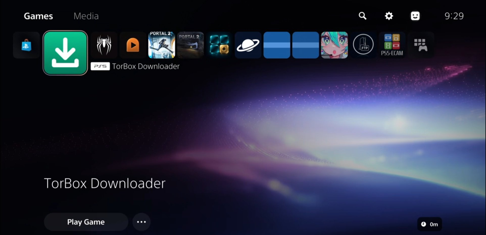
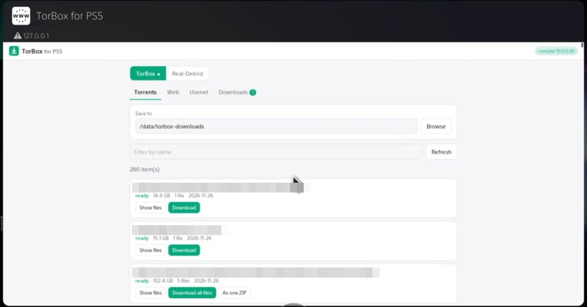
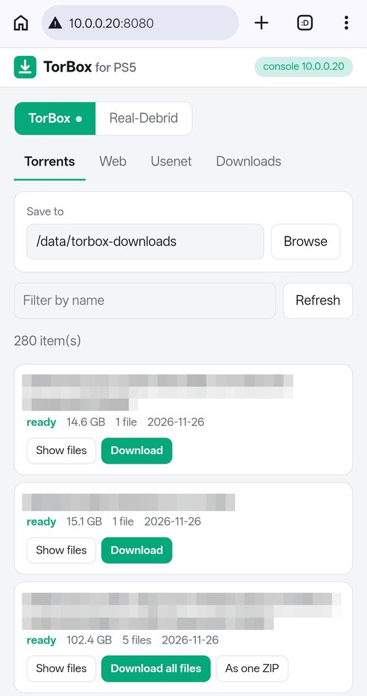

# TorBox for PS5

Browse your [TorBox](https://torbox.app), [Real-Debrid](https://real-debrid.com) and
[AllDebrid](https://alldebrid.com) accounts and download their
files **onto a jailbroken PS5**, from a web page you open on your phone or PC: `http://<console-ip>:8089` (or on
the TV: the home-screen tile opens it in the PS5's browser).

- Three services, switched at the top of the page, each with its own login (TorBox API key, Real-Debrid API token,
  AllDebrid API key), checked with the service and then stored on the console. Logging out of one keeps the others.
- TorBox: torrents, web downloads and usenet lists with names, sizes, status and the files inside each item.
- Real-Debrid: torrents (status, size, progress, files) and the download history. Hoster links are turned into
  direct links ("unrestricted") when a download starts.
- AllDebrid: magnets (status, size, the files inside), saved links and recent links. Links are unlocked into
  direct links when a download starts.
- Download one file, all files of an item (folder structure kept), or the item as one ZIP, to a folder you choose:
  type it or pick it with the folder browser (`/data/...` and USB drives `/mnt/usbN`, `/mnt/extN`).
- Progress bar, bytes, speed, time left, connections in use. Pause, resume, cancel, retry, a queue.
- Up to 32 HTTP Range connections per file (*Auto*, which goes up to 16, or a fixed 1 to 32), 50 to 100 MB/s
  from TorBox and Real-Debrid on the console. When a connection finishes its part it splits the largest remaining part, so all connections stay busy
  until the end. *Auto* halves the connection count when the server pushes back (429, 5xx, timeouts) and grows it
  again when things settle.
- Partial files resume: after a pause, an error, a network drop, a server restart or a console reboot, the download
  continues from the `.part` file and its segment table (`.part.state`); nothing finished is fetched again. A
  partial file is never deleted except by *Cancel*: when it can't be continued, the download stops and says why.
- A TorBox download server that fails or stalls is replaced: the download asks TorBox for a fresh link and
  continues the partial file.
- USB drives (`/mnt/usbN`, usually exFAT) are written strictly in order, which exFAT needs to stay fast.
- *Logs* (at the bottom of the page) shows the event log: speeds, connections, disk writes and errors.
- A link box: any direct `http(s)://` URL, or a hoster link unrestricted by Real-Debrid or unlocked by AllDebrid.
- Update check: the page tells you when a newer release is out on GitHub (*Check for updates* at the bottom).

## Screenshots

The tile on the PS5 home screen, the page in the PS5's browser (opened by the tile), and the same page on a phone
(item names blurred):

<p>
  
</p>
<p>
  
  
</p>

## How it runs (and why)

There are two pieces:

| Piece | What it is | Why |
|---|---|---|
| `torbox-ps5.elf` | The web server and downloader, a payload for the ELF loader (elfldr, port 9021). | Runs in the background, independent of any app: downloads continue while you play. |
| `PPSA97630` title | A home-screen tile, "TorBox Downloader". Opening it starts the server if it isn't running (sends `torbox-ps5.elf` to elfldr on `127.0.0.1:9021`), opens the PS5's web browser on `http://127.0.0.1:8089` (the same page, on the TV, controlled with the controller), and closes itself. | One tap to start and use, like your other homebrew. |

The server is deliberately **not** inside the title. A PS5 game or app is closed when another game starts and
stops in rest mode. A server living in the title would cut downloads off as soon as you started a game. The
payload runs on its own, so you can start a download and play something else.

The tile needs the ELF loader listening on port 9021, which is how this console's jailbreak loads payloads.
Without it, the tile tells you so, and you can send `torbox-ps5.elf` with any payload sender instead.

The server stops when you press **Stop server** in the web page, or when the console reboots or enters rest
mode. Rest mode also suspends payloads. Unfinished downloads are kept in the queue and continue the next time
the server starts.

## Install

You need FTP access to the console (e.g. zftpd on port 2120 or 2121) and ShadowMountPlus to register titles.

1. Copy the `PPSA97630` folder (from the release zip, or `build/PPSA97630` after building) to
   **`/data/homebrew/PPSA97630/`**. With curl:
   ```sh
   IP=192.168.1.50   # your console's IP
   H=ftp://$IP:2120 D=build/PPSA97630
   for f in eboot.bin torbox-ps5.elf sce_sys/param.json sce_sys/icon0.png sce_module/libc.prx; do
       curl --disable-epsv --ftp-create-dirs -T "$D/$f" "$H/data/homebrew/PPSA97630/$f"
   done
   curl --disable-epsv -Q "SITE CHMOD 755 /data/homebrew/PPSA97630/eboot.bin" \
        -Q "SITE CHMOD 755 /data/homebrew/PPSA97630/sce_module/libc.prx" "$H/data/homebrew/PPSA97630/"
   ```
   It must end up as:
   ```
   /data/homebrew/PPSA97630/eboot.bin            (chmod 755)
   /data/homebrew/PPSA97630/torbox-ps5.elf
   /data/homebrew/PPSA97630/sce_sys/param.json
   /data/homebrew/PPSA97630/sce_sys/icon0.png
   /data/homebrew/PPSA97630/sce_module/libc.prx  (chmod 755)
   ```
   The last command sets the two modes (or use your FTP client's chmod, or the shell server's `chmod 755 <file>`).
2. Register the title with ShadowMountPlus. "TorBox Downloader" appears on the home screen.
3. Open the tile. The server starts (a notification shows `TorBox: open http://<console-ip>:8089 in a browser`)
   and the PS5's browser opens on the page. You can also use the page from a phone or PC at that address.

**Without the title:** send the payload yourself: `cat torbox-ps5.elf > /dev/tcp/<console-ip>/9021` (Linux/WSL),
or with any payload sender to port 9021.

**Update:** the page shows a notice when a newer release is out (the console asks the GitHub API for the
latest release of this repository, at most every 6 hours; nothing about you or your accounts is sent). Press
*Stop server* on the page, replace the files, start again. Downloads resume. Since 1.1.1 the page is on port
**8089** (it was 8080): a new server that finds an older one still running on 8080 stops it first, so two servers
never work on the same downloads.

## Use

1. On a phone or PC on the same network open `http://<console-ip>:8089`.
2. Pick the service at the top (*TorBox*, *Real-Debrid* or *AllDebrid*; a dot marks the ones you are logged in
   to; `http://<console-ip>:8089/#realdebrid` or `#alldebrid` opens one directly) and paste its key:
   - TorBox: the API key from torbox.app, Settings, API Key.
   - Real-Debrid: the private API token from <https://real-debrid.com/apitoken> (while logged in there).
   - AllDebrid: an API key from <https://alldebrid.com/apikeys> (while logged in there).

   The key is checked with the service first (TorBox `user/me`, Real-Debrid `/user`, which also shows your account
   type and premium expiry; AllDebrid `/v4/user`). It is stored **unencrypted** on the console
   (`/data/torbox-ps5/torbox-key.txt`, `realdebrid-token.txt`, `alldebrid-key.txt`) and never sent back to the browser. *Log out* deletes that service's
   key only.
3. TorBox: *Torrents*, *Web* or *Usenet*. Real-Debrid: *Torrents* (100 per page, *Load more* for the rest) or
   *History* (your earlier unrestricted downloads). AllDebrid: *Magnets*, *Saved links* or *History*. *Show files*
   lists a torrent's or magnet's files. *Refresh* reloads.
4. Set *Save to* (default `/data/torbox-downloads`) or press *Browse* to pick or create a folder. The folder is
   remembered by your browser.
5. *Download* (one file, saved directly in the folder), *Download all files* (into `<folder>/<item name>/...`), or
   *As one ZIP*. The *Downloads* tab shows the queue. Items still downloading on TorBox's side can't be
   downloaded yet.
6. In *Downloads*: *Connections per file* (*Auto*, the default, or 1 to 32) and *Files at a time* apply to
   downloads that start (or resume) from then on. Pause, then Resume, to change the connections of a running
   download. *Remove from list* keeps a paused or failed download's partial file, so adding the file again
   continues it; *Cancel* deletes it.

### Real-Debrid details

- Real-Debrid gives one link per *selected* file of a torrent, in file order; the page pairs them, so *Download*
  next to a file fetches that file, and *Download all files* fetches every selected file into
  `<folder>/<torrent name>/<path inside the torrent>`. When the counts differ (Real-Debrid packed the files into an
  archive), the page lists the links on their own; each is named by Real-Debrid when it starts.
- A download asks Real-Debrid to unrestrict its hoster link when it starts. Direct links expire: after a pause, an
  error, a server restart or a reboot the download unrestricts again and continues the partial file. Direct links
  are kept in memory only, never on disk or in the log. Real-Debrid's per-link connection limit ("chunks") caps
  the connection setting for that file.
- The app keeps under Real-Debrid's limit of 250 requests a minute and waits out HTTP 429. Errors are shown as text,
  e.g. "bad or expired API token", "permission denied (is the account premium?)", "unsupported hoster",
  "hoster temporarily unavailable", "file unavailable on the hoster", "traffic exhausted". The ones a retry cannot
  fix stop the download at once; the others are retried a few times.
- With Real-Debrid logged in, the link box has "Unrestrict with Real-Debrid" (on when Real-Debrid is the selected
  service): paste a hoster link and it is downloaded through Real-Debrid. Untick it for a plain direct link.
- Not included: adding torrents or magnets, selecting files, and the OAuth device login. Do those on
  real-debrid.com.

### AllDebrid details

- A magnet's files come as a tree; *Download all files* keeps its folders (`<folder>/<magnet name>/...`). Each file
  link is unlocked when its download starts; links the host needs time to prepare ("delayed") are waited for (up to
  2 minutes). Direct links are kept in memory only, never on disk or in the log.
- *History* lists recent links only when history is turned on in your AllDebrid account settings.
- The app stays under AllDebrid's limits (12 requests a second, 600 a minute) and waits out HTTP 429/503. Errors are
  shown as text, e.g. "bad API key", "a premium account is needed", "unsupported host", "file unavailable on the
  host"; the ones a retry cannot fix stop the download at once.
- A login from a new place can be blocked until you confirm it in the e-mail AllDebrid sends ("login blocked from
  a new location").
- Not included: adding magnets or links and the PIN login. Do those on alldebrid.com.

### Speed

Measured on this console (fw 13.60) on the owner's network:

- The console gives sockets a 64 KiB TCP receive buffer, which held one connection at about 1.2 MB/s
  (window / round-trip time). The app asks for up to 2 MiB; the console grants 512 KiB, which gave about 7.9 MB/s
  on one connection to a public mirror.
- One large file, 35 s per setting after a 10 s ramp-up (MB/s; 2026-11-27):

  | Connections | TorBox | Real-Debrid | AllDebrid |
  |---|---|---|---|
  | 8 | 51 | 85 | 53 |
  | 16 | 71 (100 on another CDN server) | 84 | 72 |
  | 24 | 58 | 83 | 55 |
  | 32 | 68 | 78 (only ~24 connections allowed) | 74 |

  **16 (or *Auto*, which ends up at 16) is the best setting for all three.** Real-Debrid is already at its best
  with 8; more than 16 brings nothing. The server you get matters more than the setting: TorBox gave 100 MB/s on one
  CDN server and 70 on another. Two files at a time gave the same total as one (about 70 MB/s), so *Files at a time*
  doesn't make downloads faster; with 1, each file finishes sooner. Version 1.0.0, which gave each connection its
  own thread and wrote to disk from it, stayed at 15 to 26 MB/s.
- At 16 connections the one network thread is busy 60 to 90% of the time, so at 100 MB/s the console's CPU (TLS
  decryption) is the next limit.
- Writes go through their own thread in blocks of up to 2 MiB, so a slow write never holds up the network. The
  console's internal storage took 130 to 180 MB/s of writes, and kept up at 100 MB/s with writes of about 12 ms.
- If you get much less, check the console's own link first. Open
  `http://<console-ip>:8089/api/speedtest?mb=200` on a PC on the same network: it streams 200 MB from the
  console (a PC on Wi-Fi limits this test too). A wired console is the safest bet.

## Files on the console

```
/data/torbox-ps5/torbox-key.txt        TorBox API key (unencrypted, mode 600)
/data/torbox-ps5/realdebrid-token.txt  Real-Debrid API token (unencrypted, mode 600)
/data/torbox-ps5/alldebrid-key.txt     AllDebrid API key (unencrypted, mode 600)
/data/torbox-ps5/queue.tsv             unfinished downloads: ids, folders, and the hoster links of Real-Debrid
                                       downloads; never direct download links or keys
/data/torbox-ps5/settings.txt     connections, files at a time
/data/torbox-ps5/log.txt          event log (never contains the key or download links)
<folder>/<name>.part(.state)      a download in progress and its segment table
```

The server also logs to klog (port 3232). *Logs* on the page (or `GET /api/log`) shows the last 32 KB of
`log.txt`.

## Security notes

- The page has no password: anyone on your network can use it while the server runs (but cannot read the key).
  Stop the server when you don't need it, and don't expose port 8089 to the internet.
- Changes need an `X-TorBox-PS5` request header, so a web page on another site cannot drive the server from your
  browser.
- Folders are limited to `/data/...`, `/mnt/usbN/...` and `/mnt/extN/...`.

## Build

Needs this checkout next to the PS5 toolchains in `../deps` (used in place, not copied):

- `deps/ps5-sdk-full`: payload SDK with libcurl 8 + OpenSSL 3 (for the server payload),
- `deps/ps5-vulkan` (native tool, app_crt, link recipe, libc.prx) and
  `deps/ps5-vulkan-template/.deps/native/ps5-payload-sdk` (for the title),
- LLD 22 through `LLVM_CONFIG` (defaults to `../source-recomp/build/ps5-toolchain/llvm-config` when present),
- python3 with numpy (icon), clang/gcc, and for the host build libcurl (`HOST_CURL`, default linuxbrew's or
  Homebrew's, else the system's). The host build and the tests also run on macOS.

```sh
./build.sh host      # Linux build for testing            -> build/host/torbox-ps5
./build.sh payload   # PS5 server payload                 -> build/torbox-ps5.elf
./build.sh title     # PS5 title, includes the payload    -> build/PPSA97630/
./build.sh package   # zip with title, payload and README -> build/torbox-ps5-<version>.zip
./build.sh all
tests/test_host.sh   # end-to-end test of the host build against tests/mock_torbox.py
```

The web UI (`web/`) and the CA certificates (`/etc/ssl/certs/ca-certificates.crt`, or `CA_BUNDLE`) are compiled
into the binary by `tools/embed.py`.

`tests/mock_torbox.py` imitates the TorBox API (`user/me`, `*/mylist`, `*/requestdl`) and the Real-Debrid API
(`/user`, paged `/torrents` with `X-Total-Count`, `/torrents/info`, `/downloads`, `/unrestrict/link`, direct links
that expire, injected 429s), the AllDebrid API (`/v4/user`, `/v4.1/magnet/status`, `/v4/magnet/files`, saved and
recent links, `/v4/link/unlock` with a delayed link) and GitHub's latest-release call, and serves test files with
Range support, broken connections, throttling, connection limits, `Retry-After`, ETags, stalls and HTTP 400s.
`tests/test_host.sh` covers the three logins and logouts, lists and paging, AllDebrid file trees, delayed links
and unsupported hosts, the update check (newer, same, older, no release), file-to-link pairing, the folder browser, single and multi-connection downloads, resume
after pause and after a restart, an expired Real-Debrid link unrestricted again, connection splitting, HTTP 429
limits, readable errors, TorBox link refresh after a stall or an HTTP 400, partial files kept when a server
misbehaves, in-order USB writes with a slow disk, the log endpoint (no secrets in it), cancel, and checksums.

### Code map

```
src/main.c       start-up
src/httpd.c      small HTTP/1.1 server (thread per connection; poll() before every socket wait)
src/api.c        JSON API: status, login, logout, list, rd/*, dirs, mkdir, download, jobs/*, settings, sha256,
                 speedtest, quit
src/net.c        providers, key storage, HTTPS client (libcurl), socket tuning
src/torbox.c     TorBox client
src/realdebrid.c Real-Debrid client (rate limit, errors, file/link pairing, unrestrict)
src/alldebrid.c  AllDebrid client (rate limit, errors, magnets and file trees, links, unlock with delayed links)
src/update.c     update check against the repository's latest GitHub release
src/dl.c         queue, downloads (curl_multi on one thread, connection control, TorBox link refresh, USB
                 in-order mode), resume, persistence
src/writer.c     disk writer thread: merges 128 KiB blocks into writes of up to 2 MiB
src/platform.c   PS5 payload / host differences (paths, notifications, klog)
web/             the page (plain HTML/CSS/JS, no external resources)
title/           launcher title: launcher.c, build_title.sh, param.json, icon
```

APIs used:
- TorBox: `GET /v1/api/user/me`, `GET /v1/api/{torrents,webdl,usenet}/mylist`,
  `GET /v1/api/{torrents,webdl,usenet}/requestdl?token=...&{torrent_id|web_id|usenet_id}=...&file_id=...|zip_link=true`.
- Real-Debrid (`https://api.real-debrid.com/rest/1.0`, `Authorization: Bearer <token>`): `GET /user`,
  `GET /torrents?page=&limit=`, `GET /torrents/info/{id}`, `GET /downloads?page=&limit=`, `POST /unrestrict/link`.
- AllDebrid (`https://api.alldebrid.com`, `Authorization: Bearer <key>`): `GET /v4/user`, `POST /v4.1/magnet/status`,
  `POST /v4/magnet/files` (`id[]`), `GET /v4/user/links`, `GET /v4/user/history`, `POST /v4/link/unlock`,
  `POST /v4/link/delayed`.
- GitHub: `GET https://api.github.com/repos/roieeedouek/torbox-ps5/releases/latest` (update check).

## Credits

The download engine of version 1.1 (curl_multi, the disk writer thread, connection control, TorBox link refresh,
USB in-order mode, the log viewer) was written by [temp-latif07](https://github.com/temp-latif07) in a fork.
